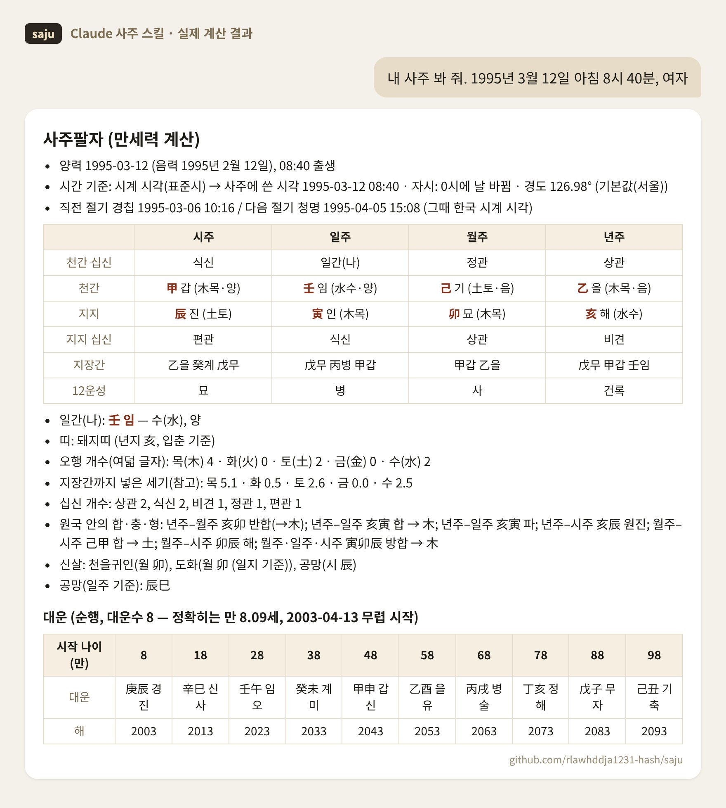

# 사주 — Claude가 사주를 '계산해서' 봅니다

**[English →](README.md)**

AI한테 사주를 물으면 기둥(간지)을 **외워서 짐작**합니다. 그런데 년주·월주·시주는 **절기 시각(분 단위)**, **옛 한국 시간대와 서머타임**, **앱마다 다른 기준**에 따라 달라집니다. 짐작하면 틀립니다.

이 스킬을 넣으면 Claude가 같이 들어 있는 만세력 계산기로 **기둥을 계산**하고, 그 결과만 가지고 풀이합니다. 설치할 프로그램은 없습니다.



## 무엇이 다른가요

| | 사주 스킬 | 그냥 AI |
|---|---|---|
| 절기 시각 | 사주는 1900~2100년. 절기 표는 서로 다른 두 계산법(수성 알고리즘, VSOP87)이 **57초 안**으로 일치 | 기억 |
| 한국 서머타임(1948~60, 1987~88)과 UTC+8:30 시절(1908~11, 1954~61) | 자동 반영. 시간대 DB와 분 단위로 맞춰 봄 | 대부분 무시 |
| 한국 음력(한국천문연구원 기준) 1900~2049년, 윤달 | ✅ | 하루씩 틀리기 쉬움 |
| 앱마다 다른 기준(시계 시각 / 경도 보정 / 진태양시, 0시·23시 날 바뀜) | 흔한 기본값을 쓰고, **다른 기준이면 기둥이 바뀔 때 알려 줌** | 말 안 함 |
| 절기 몇 분 앞뒤에 태어남 | ⚠️ 월주(입춘이면 년주까지)가 출생 시각에 달렸다고 알려 줌 | 말 안 함 |

### 시험 결과

- 무작위 **3만 개 순간**(그중 1만 개는 절기 앞뒤 90초 안)을 독립 라이브러리 [lunar-python](https://github.com/6tail/lunar-python)과 비교했더니 네 기둥 **불일치 0개**. 23시 날 바뀜 방식도 1만 5천 개에서 0개.
- 대운 3천 개: 방향과 첫 대운 모두 일치, 대운 시작 나이 차이 0.01년 이내.
- 한국 음력↔양력 18,242일 확인, 오류 0개.
- 입춘 시각이 한국천문연구원 발표와 분까지 같음(2000-02-04 21:40, 1984-02-05 00:19, 2026-02-04 05:02).
- 직접 확인: `python3 plugins/saju/skills/saju/tests/selftest.py`

## 할 수 있는 것

- 사주팔자 표: 지장간, 십신, 12운성, 오행 개수
- 원국 안의 합·충·형·해·파·원진
- 신살: 천을귀인, 도화, 역마, 화개, 양인, 괴강, 공망
- **대운**(정확한 대운수)과 **세운**(해마다 원국과 어떻게 부딪히는지)
- **궁합**: 일간끼리 관계, 일주(배우자 자리)끼리 합·충, 두 사람 사이의 합·충, 서로 없는 오행 채워 주기
- **띠별 운세**: 12띠마다 그해와의 충·합·형·원진, 삼재(들·눌·날). 띠는 입춘 기준으로 정함(1월 1일·설날 기준과 다른 1~2월생을 바로잡아 줌)
- 오늘 일진, 한 해의 24절기 시각, 양력↔음력 바꾸기
- 한국어·영어 출력, `--json`

## 설치

### Claude Code
```
/plugin marketplace add rlawhddja1231-hash/saju
/plugin install saju@saju-plugins
```

### claude.ai (웹·앱)
1. [`saju.zip`](https://github.com/rlawhddja1231-hash/saju/raw/main/dist/saju.zip)을 받습니다.
2. claude.ai → 사용자 지정 → Skills → **+ 추가 → Skill 업로드**로 올립니다.
3. 코드 실행 기능이 켜져 있어야 합니다.

## 쓰는 법

Claude에게 그냥 말하면 됩니다.

- "내 사주 봐 줘. 1990년 5월 15일 오후 2시 30분, 여자, 서울"
- "음력 1990년 4월 21일생 남자, 시간은 몰라. 지금 대운이 뭐야?"
- "궁합 봐 줘. 나 1990-05-15 14:30 여, 남친 1988-07-01 23:20 남"
- "오늘 일진 뭐야?"
- "2026년 띠별 운세 보여 줘" / "나 1990년 2월 2일생인데 무슨 띠야? 올해 삼재야?"

| 옵션 | 뜻 |
|---|---|
| `--basis clock`(기본) / `lmt` / `true` | 시계 시각 / 경도 보정(서울이면 약 32분 늦춤) / 진태양시 |
| `--zi midnight`(기본) / `23` | 0시에 날 바뀜 / 23시에 날 바뀜(조자시 통일) |
| `--place 부산` 또는 `--lon 129.08` | 태어난 곳(경도 보정에 씀) |
| `--tz America/New_York` 또는 `--tz UTC-5` | 한국 밖에서 태어났을 때 |

예시: [사주 표](docs/example-ko.md) · [입춘 10분 전 출생](docs/example-boundary.md) · [궁합](docs/example-compat.md)

## 풀이 태도

재미와 자기 이해를 위한 풀이입니다. "운명"이 아니라 "경향"으로 말합니다. 죽음, 병, 이혼을 예언하지 않고 부적이나 굿을 권하지 않습니다. 건강·돈·법의 큰 결정은 전문가에게 물어보라고 안내합니다.

## 자료 출처

- 절기 시각: [lunar-python](https://github.com/6tail/lunar-python)(MIT)으로 만들고 [PyEphem](https://rhodesmill.org/pyephem/)(VSOP87)으로 맞춰 봄. 만드는 코드는 `dev/`에 있습니다.
- 한국 음력: [korean_lunar_calendar_py](https://github.com/usingsky/korean_lunar_calendar_py)(MIT, 한국천문연구원 자료 기반)
- 한국 시간대 역사: IANA 시간대 데이터베이스(`Asia/Seoul`)와 같음

MIT 라이선스.
